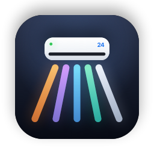
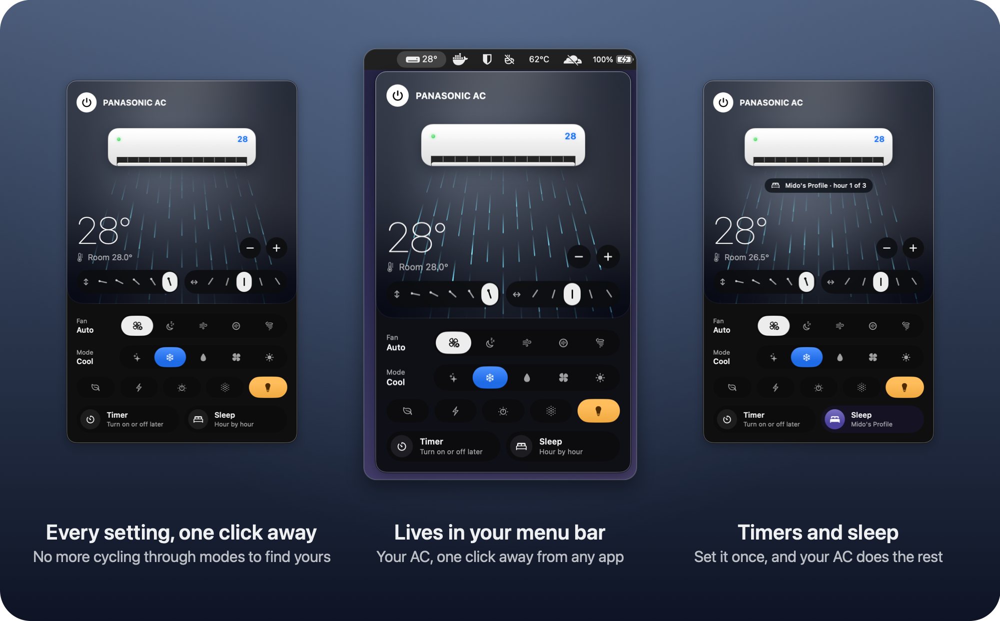
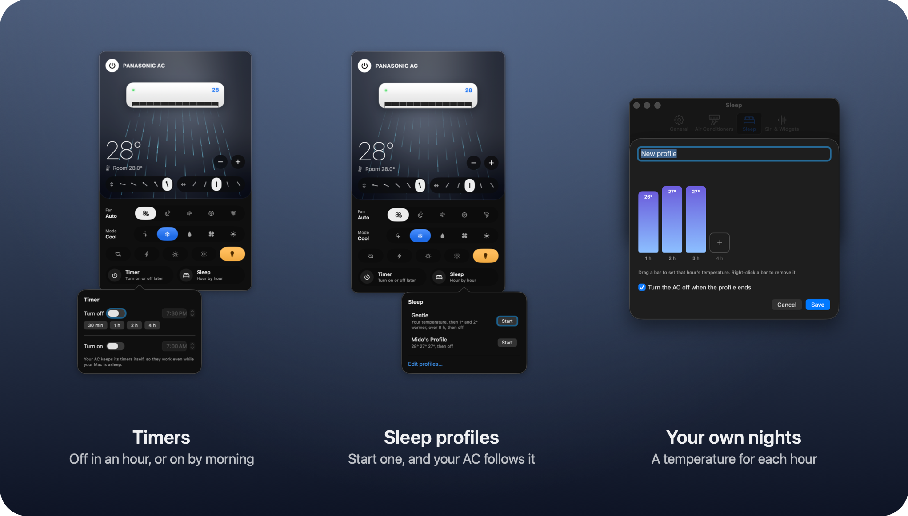
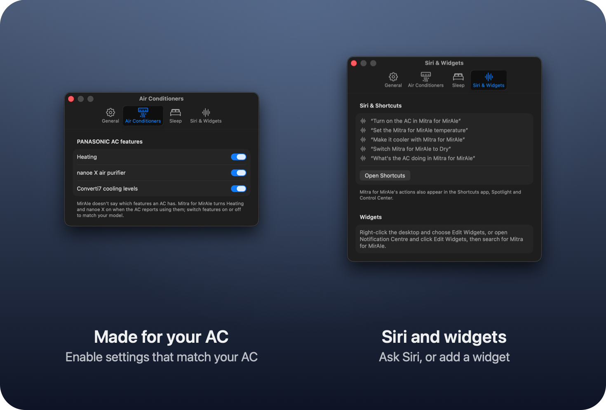
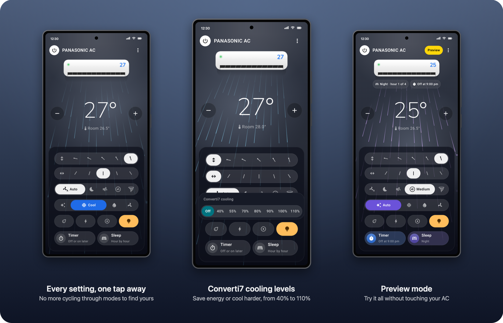
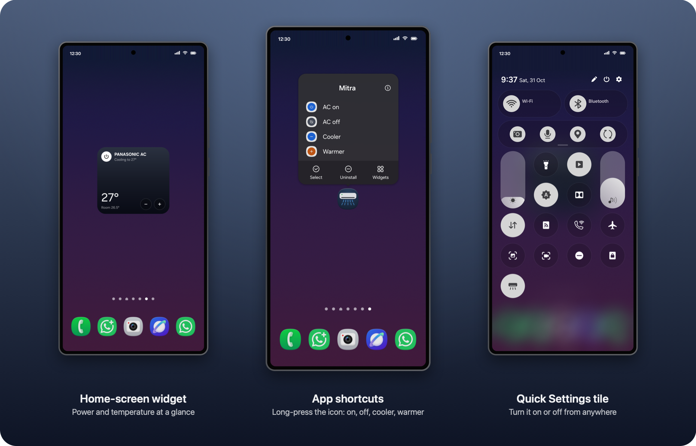
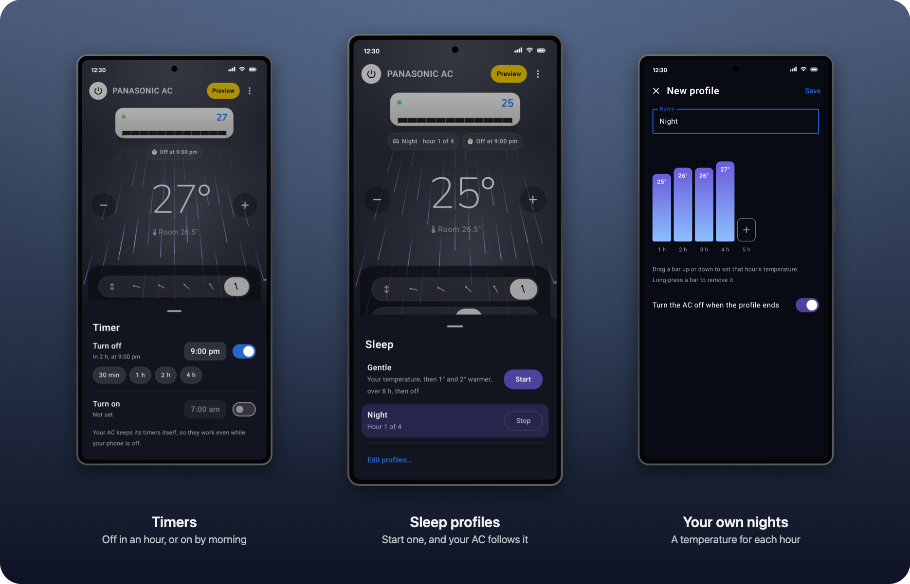

  

<h1 align="center">Mitra for MirAIe</h1>

  <strong>Control your Panasonic AC from your Mac.</strong> 
  No more reaching for the remote or your phone: Mitra puts your MirAIe AC in the menu bar of your
  MacBook or any Mac. Pick any mode, fan speed or air direction in one click, instead of cycling
  through them, and watch the air flow while you do it. On Android too. 
  A free, open-source alternative to the MirAIe app.

  <a href="https://mitra.midoreigh.com"><strong>mitra.midoreigh.com</strong></a>: see it in action and
  play with the drawn AC and its controls, right in your browser.

  <a href="https://github.com/midoreigh/mitra-for-miraie/releases/latest"><strong>Download for Mac</strong></a>
  ·
  <a href="https://github.com/midoreigh/mitra-for-miraie/releases/tag/android-v1.0.2"><strong>Download for Android</strong></a>
  ·
  <a href="#install">Install guide</a>
  ·
  <a href="#faq">FAQ</a>

  
  
  
  
  

https://github.com/user-attachments/assets/641fbb59-b6c4-4b0b-a82d-7edefc93932f

## Why you'll like it

**Your AC, from your Mac.** There's been no easy way to control a Panasonic MirAIe AC from a
computer: it was the physical remote or the MirAIe app on your phone. Mitra puts your AC in the
menu bar of your MacBook or any Mac, with the set temperature beside the icon and every control one
click away, from any app.

**Go straight to the setting you want.** On the remote and in the MirAIe app, the mode is a single
button you tap again and again, stepping through every mode until you land on the one you want,
and fan speed and air direction work the same way. In Mitra every option is laid out in front of you, so any
mode, fan speed or air direction is just one click or tap away.

**It's always within reach.** No remote lost down the side of the sofa. On your phone, open
Mitra, or skip the app entirely with the home-screen widget, the Quick Settings tile or a
long-press on the app icon.

**You can see what your AC is doing.** Mitra draws your unit blowing air the way it really
does: the flap tilts, the air sweeps up and down and side to side at the unit's own pace, takes
the mode's colour, and drifts on Quiet or rushes on High.

**Everything the MirAIe app does, faster.** Temperature, mode, fan speed, both louvers, Eco,
Powerful, Converti7 and more, each a single click or tap away, with your AC answering in a second
or two.

**It stays in sync.** Change something with the remote or the MirAIe app and Mitra shows it
straight away. A light on the drawn unit tells you whether your AC is online.

**Just ask Siri, on your Mac.** "Turn on the AC in Mitra for MirAIe." "Make it cooler with Mitra for MirAIe."
Every action also works in Shortcuts, so your AC can switch on before you get home.

  

## Everything you can do

| | |
|---|---|
| **Power and temperature** | Turn on and off, and set 16 to 30 °C with − and +. See the room temperature your AC measures. |
| **Modes** | Auto, Cool, Dry and Fan, plus Heat on units that have it, each one click or tap away. |
| **Fan speed** | Auto, Quiet, Low, Medium and High, named as in the MirAIe app, each one click or tap away. |
| **Airflow** | Up/down and left/right: swing, or any of five positions on each, each one click or tap away. |
| **Features** | Eco, Powerful, Converti7 cooling levels, nanoe X on units that have it, and the display light. |
| **Timers and sleep** | Turn off or on at a set time, and sleep profiles with a temperature for each hour of the night. |
| **Every AC** | Switch between all the ACs on your MirAIe account. |
| **Siri and Shortcuts** (Mac) | Power, temperature, mode, fan speed, airflow and status. |
| **Widget, tile and shortcuts** (Android) | A home-screen widget, a Quick Settings tile for power, and AC on, AC off, Cooler and Warmer when you long-press the app icon. |
| **Try it first** | A demo AC to play with before signing in, and a Preview Mode that tries controls without touching your AC. |

Mitra only shows what your AC has: Heat and nanoe X appear when your unit reports them, and you
can switch features on or off for each AC in Settings. On the Mac, right-click the menu bar icon
for Refresh, Preview Mode, Settings, Sign Out and Quit; on Android, they're in the ⋮ menu.

  

  

## On Android

The same living AC and one-tap controls, made for your phone. The AC and its air fill the
screen, and every control sits on a glass panel at the bottom, within thumb reach. There's a
home-screen widget, a Quick Settings tile for power, and shortcuts when you long-press the app
icon. Timers and sleep profiles work just as they do on the Mac.

  

  

  

See [Install on Android](#install-on-android) to get it.

## Install

### Install on Mac

> [!IMPORTANT]
> **macOS will ask you to confirm Mitra: when you first open it, and again after each update.**
> Mitra is free and isn't signed with a paid Apple Developer ID, so macOS can't verify it. Both
> prompts are expected and safe to allow; all of the source is here to check.
>
> - **Open Anyway.** macOS blocks each newly downloaded version until you click **Open Anyway** in
>   **System Settings ▸ Privacy & Security** (step 2 below).
> - **Your Mac's password or Touch ID, usually twice.** Mitra keeps your MirAIe sign-in and session
>   in your Mac's Keychain, and macOS only lets the app that saved an item read it. Without a
>   Developer ID, macOS can't tell that a new version is the same app, so after each update it
>   asks once for each of the two saved items. Choose **Always Allow**; it won't ask again until the
>   next update.

1. Download **Mitra-for-MirAIe-&lt;version&gt;.dmg** from the
   [latest release](https://github.com/midoreigh/mitra-for-miraie/releases/latest), open it, and
   drag **Mitra for MirAIe** into **Applications**.
2. Open it from Applications. macOS says it can't verify the app (see the [FAQ](#faq)), so let
   it through:
   1. Click **Done** on the warning.
   2. Open **System Settings ▸ Privacy & Security** and scroll down to **Security**.
   3. Next to "Mitra for MirAIe was blocked", click **Open Anyway**, then confirm with Touch ID or
      your password.
3. Click the AC icon in the menu bar and sign in with the mobile number or email you use in the
   MirAIe app, or choose **Try it without an account** to look around first.

Requires macOS 26 or later, on Apple silicon or Intel.

**Updating:** Mitra checks for new versions once a day (or choose **Check for Updates…** from the
right-click menu). When one is out, click **Update** in the panel: Mitra downloads it and opens
the installer, and you drag the app into Applications to replace the old one. When you first open
the new version, macOS asks you to confirm it, as described above:

- **Open Anyway** in **System Settings ▸ Privacy & Security** (step 2).
- **Your Mac's login password or Touch ID**, usually twice, so the new version can use your saved
  MirAIe sign-in. Choose **Always Allow** each time. This happens after every update.

### Install on Android

> [!NOTE]
> Mitra isn't on Google Play, so Android asks you to confirm before installing it. That's
> expected and safe to allow; all of the source is here to check.

1. On your phone, download **Mitra-for-MirAIe-&lt;version&gt;.apk** from the
   [Android release](https://github.com/midoreigh/mitra-for-miraie/releases/tag/android-v1.0.2).
2. Open it. If Android asks, allow your browser (or Files app) to **install unknown apps**, then
   go back and tap **Install**. If Google Play Protect says it doesn't recognise the app, tap
   **More details ▸ Install anyway**.
3. Open Mitra for MirAIe and sign in with the mobile number or email you use in the MirAIe app, or
   choose **Try it without an account** to look around first.

Requires Android 8.0 or later. To add the widget, long-press your home screen, tap **Widgets** and
find Mitra for MirAIe; for the power tile, edit your Quick Settings panel and drag in the AC tile.

**Updating:** download the new APK from the
[releases page](https://github.com/midoreigh/mitra-for-miraie/releases) and install it over the
old one. You stay signed in.

## FAQ

**Which air conditioners does it work with?**
Panasonic ACs that you control with the MirAIe app.

**Is Mitra an alternative to the MirAIe app?**
Yes. You sign in with your MirAIe account and control the same ACs, but every mode, fan speed and
air direction is one click or tap away instead of cycling through them, and Mitra adds timers and
sleep profiles. It's free, open source and unofficial.

**Is there a MirAIe app for Mac?**
Mitra puts your MirAIe AC in your Mac's menu bar, with the set temperature beside the icon, every
control one click away, and Siri and Shortcuts. It runs on macOS 26 or later, on Apple silicon or
Intel.

**Is my password safe?**
You sign in with your MirAIe account. Your password is kept in your Mac's Keychain, or encrypted
with the Android Keystore on your phone, and is only ever sent to MirAIe's own servers. Mitra has
no analytics; apart from MirAIe, the Mac app only contacts GitHub to check for new versions, which
you can turn off in Settings, and the Android app contacts nothing else.

**Why does macOS say it can't verify the app?**
Apple only vouches for apps from developers in its paid developer program. Mitra is a free,
open-source app, so macOS asks you to confirm the first time you open it. All of the source is
here for anyone to check.

**Why does macOS ask for my password after every update, sometimes twice?**
Mitra keeps your MirAIe sign-in and session in your Mac's Keychain, where macOS only lets the app
that saved an item read it. Apps signed with a paid Apple Developer ID carry a developer identity
that stays the same from version to version; Mitra doesn't have one, so macOS treats each new
version as a different app and asks before it can read what the old one saved, once per item:
one prompt for the sign-in and one for the session. Enter your Mac's login password (or use Touch
ID) and choose **Always Allow**. It won't ask again until the next update. Your sign-in never
leaves your Mac except to sign in to MirAIe.

**Are there widgets?**
Yes, for the desktop and Notification Center, plus a Control Center toggle. They need an Apple
developer signature to share your sign-in with the app, so they're included when you
[build Mitra from source](macOS/README.md) with your own (free) Apple developer account.

**Is this an official Panasonic app?**
No. Mitra for MirAIe is an independent, unofficial app, not affiliated with or endorsed by
Panasonic. MirAIe is a trademark of Panasonic.

## Platforms

| Platform | Status | Folder |
|---|---|---|
| macOS 26 or later | Available ([download](https://github.com/midoreigh/mitra-for-miraie/releases/latest)) | [`macOS`](macOS) |
| iOS | Planned | |
| Android 8.0 or later | Available ([download](https://github.com/midoreigh/mitra-for-miraie/releases/tag/android-v1.0.2)) | [`android`](android) |

## Contributing

Bug reports, ideas and pull requests are welcome. See [CONTRIBUTING.md](CONTRIBUTING.md), and
please follow the [Code of Conduct](CODE_OF_CONDUCT.md). Report security problems privately; see
[SECURITY.md](SECURITY.md).

## License

[MIT](LICENSE) © 2026 Mido Reigh.
