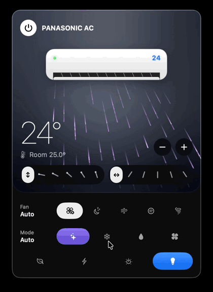
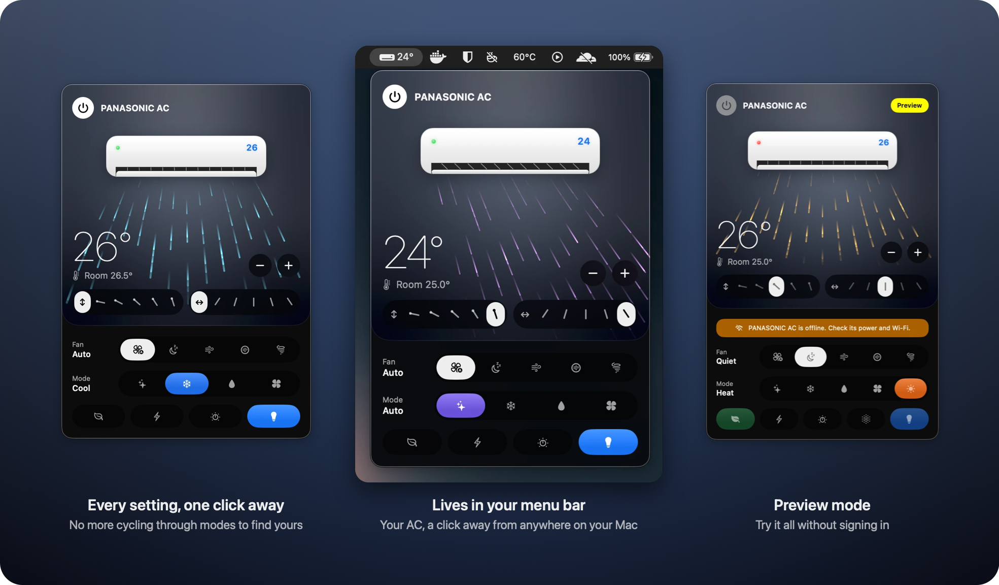
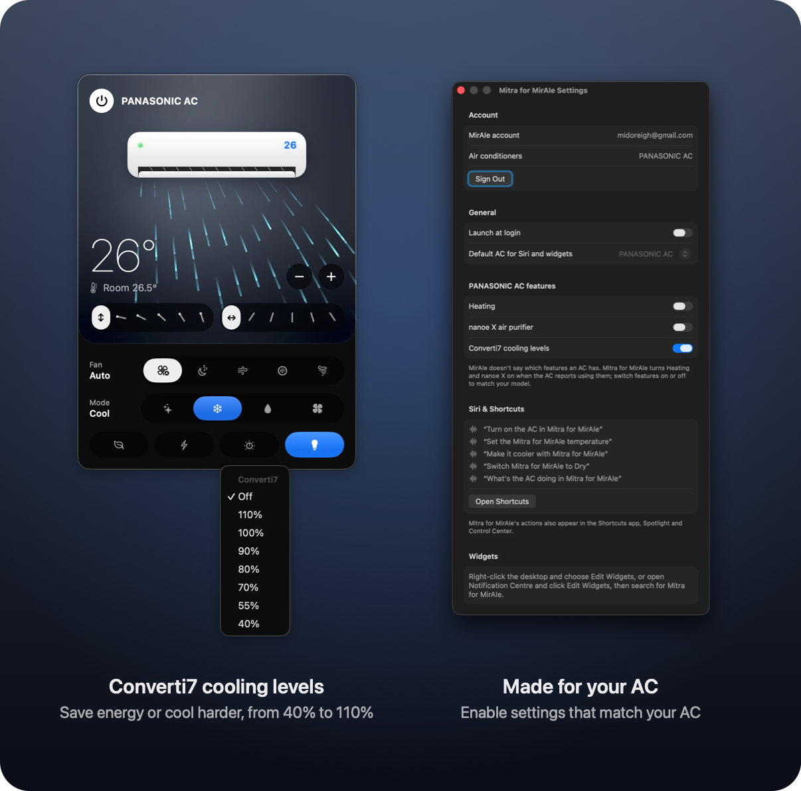

  

<h1 align="center">Mitra for MirAIe</h1>

  <strong>Your Panasonic AC, right in your Mac's menu bar.</strong> 
  Set the temperature, aim the air and switch modes in a click, and watch the air flow while you do it.

  <a href="https://github.com/midoreigh/mitra-for-miraie/releases/latest"><strong>Download for Mac</strong></a>
  ·
  <a href="#install">Install guide</a>
  ·
  <a href="#faq">FAQ</a>

  
  
  
  

  

## Why you'll like it

**Go straight to the setting you want.** In the MirAIe app, the mode is a single button you tap
again and again, stepping through every mode until you land on the one you want, and fan speed
and air direction work the same way. In Mitra every option is laid out in front of you, so any
mode, fan speed or air direction is just one click away.

**It's always one click away.** No phone to find, no app to open, no remote lost down the side of
the sofa. Click the icon in the menu bar and your AC is right there, with the set temperature
beside the icon at a glance.

**You can see what your AC is doing.** The panel draws your unit blowing air the way it really
does: the flap tilts, the air sweeps up and down and side to side at the unit's own pace, takes
the mode's colour, and drifts on Quiet or rushes on High.

**Everything the MirAIe app does, faster.** Temperature, mode, fan speed, both louvers, Eco,
Powerful, Converti7 and more, each a single click away, with your AC answering in a second or two.

**It stays in sync.** Change something with the remote or the MirAIe app and Mitra shows it
straight away. A light on the drawn unit tells you whether your AC is online.

**Just ask Siri.** "Turn on the AC in Mitra for MirAIe." "Make it cooler with Mitra for MirAIe."
Every action also works in Shortcuts, so your AC can switch on before you get home.

  

## Everything you can do

| | |
|---|---|
| **Power and temperature** | Turn on and off, and set 16 to 30 °C with − and +. See the room temperature your AC measures. |
| **Modes** | Auto, Cool, Dry and Fan, plus Heat on units that have it, each one click away. |
| **Fan speed** | Auto, Quiet, Low, Medium and High, named as in the MirAIe app, each one click away. |
| **Airflow** | Up/down and left/right: swing, or any of five positions on each, each one click away. |
| **Features** | Eco, Powerful, Converti7 cooling levels, nanoe X on units that have it, and the display light. |
| **Every AC** | Switch between all the ACs on your MirAIe account. |
| **Siri and Shortcuts** | Power, temperature, mode, fan speed, airflow and status. |
| **Try it first** | A demo AC to play with before signing in, and a Preview Mode that tries controls without touching your AC. |

Mitra only shows what your AC has: Heat and nanoe X appear when your unit reports them, and you
can switch features on or off for each AC in Settings. Right-click the menu bar icon for Refresh,
Preview Mode, Settings, Sign Out and Quit.

  

## Install

1. Download **Mitra-for-MirAIe-&lt;version&gt;.dmg** from the
   [latest release](https://github.com/midoreigh/mitra-for-miraie/releases/latest), open it, and
   drag **Mitra for MirAIe** into **Applications**.
2. Open it from Applications. The first time, macOS says it can't verify the app (see the
   [FAQ](#faq)). Click **Done**, then go to **System Settings ▸ Privacy & Security**, scroll down
   and click **Open Anyway**. You only do this once.
3. Click the AC icon in the menu bar and sign in with the mobile number or email you use in the
   MirAIe app, or choose **Try it without an account** to look around first.

Requires macOS 26 or later, on Apple silicon or Intel. To update, download the new version and
replace the app in Applications.

## FAQ

**Which air conditioners does it work with?**
Panasonic ACs that you control with the MirAIe app.

**Is my password safe?**
You sign in with your MirAIe account. Your password is kept in your Mac's Keychain and is only
ever sent to MirAIe's own servers. Mitra has no analytics and talks to no other servers.

**Why does macOS say it can't verify the app?**
Apple only vouches for apps from developers in its paid developer program. Mitra is a free,
open-source app, so macOS asks you to confirm the first time you open it. All of the source is
here for anyone to check.

**Are there widgets?**
Yes, for the desktop and Notification Center, plus a Control Center toggle. They need an Apple
developer signature to share your sign-in with the app, so they're included when you
[build Mitra from source](macOS/README.md) with your own (free) Apple developer account.

**Is this an official Panasonic app?**
No. Mitra for MirAIe is an independent, unofficial app, not affiliated with or endorsed by
Panasonic. MirAIe is a trademark of Panasonic.

## Platforms

| Platform | Status | Folder |
|---|---|---|
| macOS 26 or later | Available | [`macOS`](macOS) |
| iOS | Planned | |
| Android | Planned | |

## Contributing

Bug reports, ideas and pull requests are welcome. See [CONTRIBUTING.md](CONTRIBUTING.md), and
please follow the [Code of Conduct](CODE_OF_CONDUCT.md). Report security problems privately; see
[SECURITY.md](SECURITY.md).

## License

[MIT](LICENSE) © 2026 Mido Reigh.
